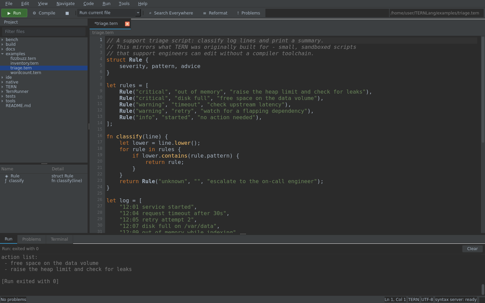

# TERN

TERN is a small, fast scripting language for people who support software:
engineers, SREs and support professionals who need to automate a job *now*
without dragging a compiler toolchain behind them. It has a modern,
expression-oriented syntax, compiles to bytecode, and runs on a stack virtual
machine written in C#.

TERN 2.x is a ground-up rewrite of the original TERN interpreter. The old
`scope X { Method { arg0 } }` / `@If(...)` syntax is gone; see
[Migrating from TERN 1.x](#migrating-from-tern-1x).

```tern
struct Ticket { id, title, severity = "minor"

    fn summary() { return "#${this.id} ${this.title} [${this.severity}]"; }
}

let tickets = [
    Ticket(1, "disk full", "critical"),
    Ticket(2, "slow login"),
    Ticket(3, "typo on the dashboard"),
];

for ticket in tickets.filter(fn(t) => t.severity == "critical") {
    println("page on-call: ${ticket.summary()}");
}

match tickets.length {
    0       => println("queue is clear"),
    1..9    => println("normal load"),
    _       => println("escalate"),
}
```

## Features

* **Modern syntax** — `let`/`const`, functions with defaults and `...rest`,
  arrow lambdas, block scoping, string interpolation, ternaries.
* **Real data structures** — lists, insertion-ordered maps, lazy ranges, and
  user-defined structs with methods and defaults.
* **Pattern matching** — literals, ranges (including negative ones),
  or-patterns, guards, list patterns with `...rest` and map patterns that
  destructure by key, nestable and usable as an expression.
* **Errors as values** — `try` / `catch` / `finally` with `throw`, plus
  catchable runtime errors and stack traces with exact line numbers, on both
  the interpreter and the compiled backend.
* **Batteries included** — `math`, `json`, `fs`, `os`, `time`, `random`,
  `text`, `lists`, `net`, `http`, `rcon`, `sftp`, `gl` and `d3d12` namespaces
  and rich methods on every built-in type.
* **Networking** — `std:net` sends values, not bytes: `net.send` encodes and
  frames any value (structs included) and `net.receive` decodes it back. The
  wire format is shared with the compiled backend, so a native client can talk
  to an interpreted server. Connections can carry a token, cap the frame size,
  time out and run over TLS; `std:http` is a client for `http://` and
  `https://`, `std:rcon` speaks the Source RCON protocol, `std:sftp` moves files
  over SSH by driving the OpenSSH client, and `net.udpListen`/`udpSend`/
  `udpReceive` cover datagrams.
* **Modules** — `import "lib/util.tern"` for files, `import "std:json"` for
  standard modules, with per-engine caching.
* **A single dependency-free binary** — a bytecode VM with no runtime
  reflection in the hot path.
* **Ahead-of-time compilation** — `tern emit` plus `native/` turn the same
  bytecode into C and then into a standalone ELF binary with no runtime
  installed ([`native/README.md`](native/README.md)).
* **Sandboxable** — file system and network access can be disabled per engine,
  so scripts from a ticket or a chat bot can be run safely.
* **Linted on the way in** — a fast AST pass warns about assignments used as
  conditions, impossible comparisons and shadowed locals before anything runs.

## Quick start

```bash
# one-time toolchain bootstrap (fetches Roslyn + a private .NET runtime)
./tools/setup-toolchain.sh

# build the VM and CLI
./tools/build.py

# run something
./tools/tern run examples/triage.tern

# other commands
./tools/tern check examples/triage.tern   # compile only, report diagnostics and warnings
./tools/tern disasm examples/triage.tern  # dump bytecode
./tools/tern repl                         # interactive (:help for commands)
./tools/tern docs                         # standard library reference (markdown)
./tools/tern emit examples/triage.tern -o triage.json   # bytecode as JSON
./tools/tern version

# compile a script to a standalone native binary
native/build.sh examples/triage.tern -o triage && ./triage
```

Script arguments are exposed as `os.args()`:

```bash
./tools/tern run examples/wordcount.tern notes.txt
```

Add `--time` to `run` for a wall-clock measurement and `--no-fs` / `--no-net` to
run with the file system or the network sandboxed.

## Language tour

Full reference: [`docs/language.md`](docs/language.md) for the language and
[`docs/stdlib.md`](docs/stdlib.md) for every builtin, generated from the code
with `tern docs`.

### Values

`int` · `float` · `string` · `bool` · `nil` · `list` · `map` · `range` ·
`function` · struct instances. Integers stay integers, division promotes to
float only when it is inexact (`7 / 2` is `3.5`, `8 / 2` is `4`), and
`1 == 1.0` is `true`.

### Strings

```tern
let name = "tern";
println("hello, ${name.upper()}!");         // hello, TERN!
println("a-b-c".split("-").join(" + "));    // a + b + c
println("abc"[1..<3]);                      // bc
println("x".padStart(3, "."));              // ..x
```

### Collections

```tern
let xs = [3, 1, 2];
xs.sort();                       // in place, stable
xs.map(fn(v) => v * 2);          // [6, 2, 4]
xs.filter(fn(v) => v > 1);       // [3, 2]
xs.reduce(fn(acc, v) => acc + v, 0);

let counts = {};
counts["a"] = 1;
counts.has("a");                 // true
for key, value in counts { println("${key}=${value}"); }

2 in xs;                         // true
len(0..<5);                      // 5, a range is lazy
```

### Functions and closures

```tern
fn greet(name, greeting = "hello", ...rest) {
    return "${greeting}, ${name} (${rest.length})";
}

fn counter() {
    let n = 0;
    return fn() { n++; return n; };
}
```

### Structs

```tern
struct Stack {
    items = []                     // defaults run per instance

    fn push(v) { this.items.push(v); return this; }
    fn size() { return this.items.length; }
}

let s = Stack().push(1).push(2);
println(s.size());                  // 2
```

### Errors

```tern
try {
    let value = json.parse(payload);
} catch (e) {
    println("bad payload: ${e}");
} finally {
    println("done");
}
```

Uncaught errors print a message plus a stack trace and exit with status 1:

```
TypeError: nil has no method 'missing'
  at inner (app:1)
  at outer (app:2)
  at <module> (app:3)
```

## Performance

`tools/compare.sh` runs five workloads written identically in TERN (interpreted
and compiled), Lua 5.4, LuaJIT, Node 22 and C# (Roslyn) and compares in-process
timings, so startup and host warm-up are excluded. Best of five runs on a 2 vCPU
/ 2.6 GHz machine:

| Workload   | TERN | TERN native | Lua 5.4 | LuaJIT | Node 22 | C#   | TERN / Lua |
| ---------- | ---: | ----------: | ------: | -----: | ------: | ---: | ---------: |
| `fib`      |  127 |          18 |      55 |      6 |      10 |    5 |      2.30x |
| `loop`     |  116 |           5 |      31 |     12 |       9 |    5 |      3.69x |
| `maps`     |  187 |         150 |     177 |     59 |     109 |   71 |      1.06x |
| `bintree`  |   49 |           5 |      34 |      7 |       5 |   26 |      1.42x |
| `strings`  |   22 |           5 |      11 |      5 |       3 |    4 |      1.91x |

TERN is within 1.1x of Lua on `maps` and 3.7x behind on the tight numeric
loop; LuaJIT, Node and C# are tracing/AOT compilers
and are 10-25x ahead on numeric code. How much of that the compiled backend
takes back depends on the workload: 7x on `fib`, 23x on `loop`, 10x on
`bintree`, and nothing at all on `maps`, where a table write costs what it costs
whichever language performs it. Compiled, TERN is ahead of LuaJIT on `loop`
and `bintree`, level on `strings`, and 2.5-3x behind on `fib` and `maps`.

These numbers move by up to 30% with host load: the same suite measured `maps`
at 0.74x of Lua in an earlier session. See `bench/compare/workloads.md` for
per-workload notes and the remaining per-opcode costs.

`for` loops over lists, maps, strings and ranges used to leave one stack slot
behind per iteration (`IterNext` kept the iterator it had already advanced).
That grew the operand stack without bound — a 20 million iteration loop reached
1.5 GB — and it is fixed: the same loop now peaks at 45 MB and runs 1.9x faster
(2.64 s -> 1.36 s).

Whole-process times for the equivalent scripts (`./tools/bench.sh`, including
~90 ms of process start, parse, compile and JIT):

| Benchmark      | Workload                                   | Time      |
| -------------- | ------------------------------------------ | --------- |
| `fib.tern`     | `fib(30)`, 2.7 M calls                     | ~200 ms   |
| `loop.tern`    | 5 M iteration numeric loop                 | ~194 ms   |
| `maps.tern`    | 200 k string-keyed inserts + 200 k lookups | ~194 ms   |
| `bintree.tern` | 65 535-node struct tree, alloc heavy       | ~96 ms    |
| `strings.tern` | 20 k interpolations + join/split/upper     | ~66 ms    |

The optimisations that get there:

* **Tagged `Value` structs** — numbers and booleans never box inside the
  interpreter loop.
* **A single dispatch loop** over a contiguous `Instr[]`, with the whole
  instruction (opcode plus three operands) in one 16-byte struct and a
  `[MethodImpl(AggressiveOptimization)]` entry point so the interpreter is fully
  optimised from its first call while everything else stays quick-jitted for a
  fast start.
* **Fused opcodes** — `AddLocalLocal`, `AddLocalConst`, `AddLocalConstStore`,
  `AddLocalStack`, `JumpLtLocalInt`, `Length`, `StoreIndexDiscard`, ... so
  `total += i % 7` is three instructions and `m[k] = v;` is four.
* **Counted loops** — `ForPrep{Lt,Le,Gt,Ge}` / `ForNext{Lt,Le,Gt,Ge}` fold the
  increment, the comparison and the branch into one opcode per iteration, and
  update the counter in place.
* **Reciprocal modulo** — `x % k` for a positive constant `k` becomes a
  64x64→128 multiply and a shift, with an exact range check that falls back to
  the hardware divide.
* **Cheap calls** — pooled pre-populated frames, per-frame stack reservation, an
  unrolled argument copy for the first nine arities, and inline return paths.
* **Cheap builtin calls** — a direct-mapped method cache replaces the builtin
  dictionary lookups, and argument buffers are reused per nesting depth instead
  of allocating a `Value[]` per call.
* **Allocation-light strings** — interpolations of ints, bools and strings are
  written into a stack buffer and copied once into the result string.
* **Constant folding** in the compiler, including integer `**`.
* **Locals in a flat slot array** — parameters, receivers and loop counters are
  index-addressed, never looked up by name at runtime.
* **Jump targets patched at emit time**, so there is no runtime branch
  resolution.
* **String keys hashed without allocation** in the map implementation.

### Compiled with the native backend

`native/ternc.py` translates the same `bench.tern` to C and compiles it with
`cc -O2`; `tools/compare.sh` runs the result as an extra column, on the same
workloads and the same in-process clock, so the two TERN columns are directly
comparable.

| | `fib` | `loop` | `maps` | `bintree` | `strings` |
| --- | ---: | ---: | ---: | ---: | ---: |
| interpreted | 127 | 116 | 187 | 49 | 22 |
| compiled | 18 | 5 | 150 | 5 | 5 |
| speed-up | 7.1x | 23x | 1.2x | 9.8x | 4.4x |

What compiling cannot fix is memory latency. A map write is a hash, a probe into
a table large enough to leave cache, and — while the table grows — a rehash. The
same loop writing 800 000 integer keys takes 199 ms compiled and 197 ms
interpreted, and `TERN_GC_STATS=1` reports zero collections: the table is
`malloc`ed outside the GC heap, so the collector is not the cost either. `maps`
is the one workload where the interpreter's BCL dictionary is as good as the
generated C.

Compiled binaries keep the interpreter's stack traces, which costs about two
cycles per call (`fib` would be 10% faster without them). Building a binary
takes about 4 s, almost all of it `cc -O2` over the runtime, and the result is
~220 KB; a hello-world binary starts in 2 ms against 112 ms of .NET start-up for
the interpreter.

Objects are allocated from per-size-class free lists and reclaimed by a
mark-sweep collector whose roots are the registered global/constant arrays plus
a conservative scan of the C stack, so generated code does not describe its
frames: programs that allocate in a loop stay flat instead of growing.

## The IDE

`TERN Studio` is a desktop IDE for the language, built the way Rider is: a
window that does no analysis of its own, and a language server in a separate
process that does all of it.



```bash
python3 -m venv .venv && .venv/bin/pip install PySide6-Essentials
bash tools/ide.sh
```

It has live diagnostics, completion, hover documentation, go-to-definition,
find usages, rename, a structure view, a run/compile window with streaming
output, project and problems tool windows, two themes and a full keymap. See
[`docs/ide.md`](docs/ide.md) for what is there, and for the short list of what
is not — no debugger yet, and no VCS panel.

The server half is a plain LSP 3.17 server over stdio (`build/TERN.Ide.dll`), so
any editor with LSP support can use it, not just Studio:

```bash
tools/tern-ls          # speaks LSP on stdin/stdout
```

## Repository layout

```
TERN/               the language: lexer, parser, compiler, bytecode, VM, builtins
  Syntax/           Lexer.cs, Ast.cs, Parser.cs
  Compiler/         Bytecode.cs, Compiler.cs, Disassembler.cs
  Runtime/          Value.cs, Objects.cs, VM.cs
  Builtins/         BuiltinMethods.cs, StandardLibrary.cs
  TernEngine.cs     embeddable engine: modules, compilation, sandboxing
  Diagnostics.cs    diagnostics and TernError
TernRunner/         the `tern` CLI (run / check / repl / disasm / version)
ide/Server/         the language server (TERN.Ide.dll), LSP over stdio
ide/Studio/         TERN Studio, the PySide6 desktop IDE
tools/              build.py, tern launcher, test.sh, bench.sh, gen-docs.sh,
                    setup-toolchain.sh
tests/              golden-output test suite (NN_name.tern + NN_name.out)
examples/           runnable sample scripts
bench/              micro benchmarks
native/             AOT backend: bytecode -> C -> ELF (ternc.py, runtime/, tests)
docs/ide.md         TERN Studio: the IDE and its syntax server
docs/language.md    the language reference
docs/stdlib.md      generated builtin reference (`tools/gen-docs.sh`)
```

## Embedding

```csharp
using TERN;
using TERN.Runtime;

// The standard library is installed by the constructor.
var engine = new TernEngine(includeStandardLibrary: true);
engine.AllowFileSystem = false;           // sandbox: no file system access
engine.AllowNetwork = false;              // sandbox: no sockets (encode/decode still work)
engine.ScriptArguments.Add("notes.txt");

// Run source directly...
var value = engine.RunScript("""println("hi from TERN");  1 + 2""", "inline");

// ...or a file, then read the value its top level produced.
var module = engine.LoadFile("script.tern");
var result = engine.Execute(module);

// Expose host functions to scripts.
engine.RegisterFunction("log", (vm, args) =>
{
    Console.WriteLine(args[0].ToDisplayString());
    return Value.Nil;
}, minArguments: 1, maxArguments: 1, documentation: "Writes a line to the host log.");
```

Errors surfacing from TERN are `TernError` values carrying the message, the
error type and a `Trace` of `(function, line)` frames, so a host can render
them however it likes instead of parsing console output.

The VM also enforces resource ceilings, configurable through
`engine.Options`: `MaxInstructions` (default 2e9), `MaxCallDepth` (1024),
`MaxCollectionSize` (8 M elements) and `MaxStringLength` (16 M chars). They
turn runaway scripts into catchable errors instead of host OOM crashes.

## Development

```bash
./tools/build.py          # compile everything (add --debug for debug info)
./tools/test.sh           # run the golden test suite
./tools/test.sh --update  # re-freeze expected outputs after intentional changes
./tools/bench.sh          # run the benchmarks
./tools/gen-docs.sh       # regenerate docs/stdlib.md from the engine
```

The suite is plain TERN: each `tests/NN_name.tern` is run and compared against
`tests/NN_name.out`, so adding a test means adding one file and freezing its
output. `tools/test.sh` also fails when `docs/stdlib.md` drifts from the
registered standard library.

## Migrating from TERN 1.x

TERN 2.x is not backward compatible. The table maps the old constructs:

| TERN 1.x                        | TERN 2.x                            |
| ------------------------------- | ----------------------------------- |
| `scope Console { ... }`         | plain top-level functions, or a module |
| `Method { arg0 arg1 }`          | `fn method(a, b) { ... }`           |
| `arg0 .. argN`                  | named parameters                    |
| `@If(cond) { }`                 | `if cond { }`                       |
| `@For` / `@Foreach`             | `for item in list { }`              |
| string `+` only                 | interpolation: `"${value}"`         |
| errors as console text          | `try` / `catch` / `finally`         |

## License

See the repository for licensing information.
