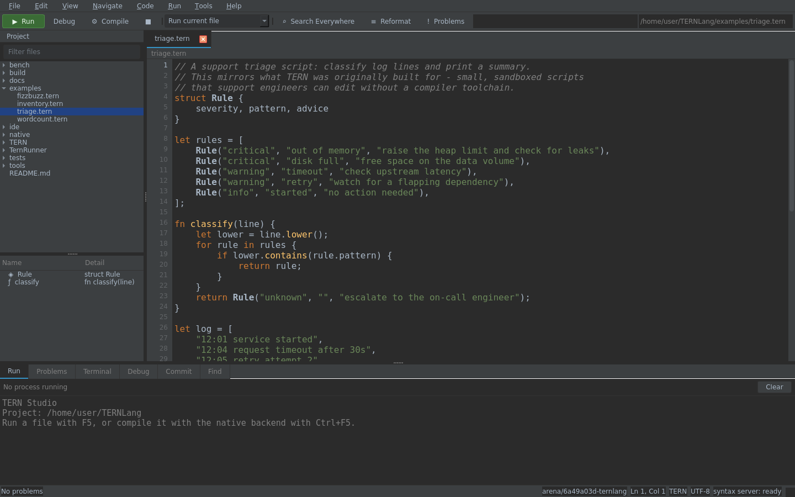
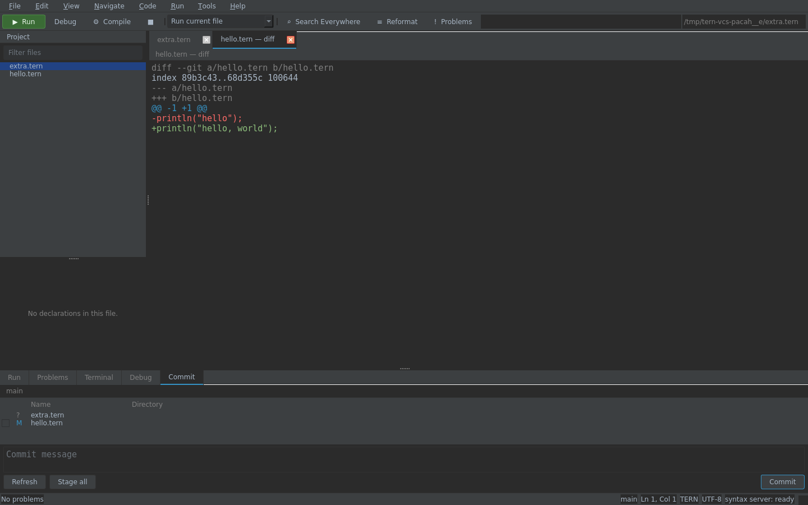
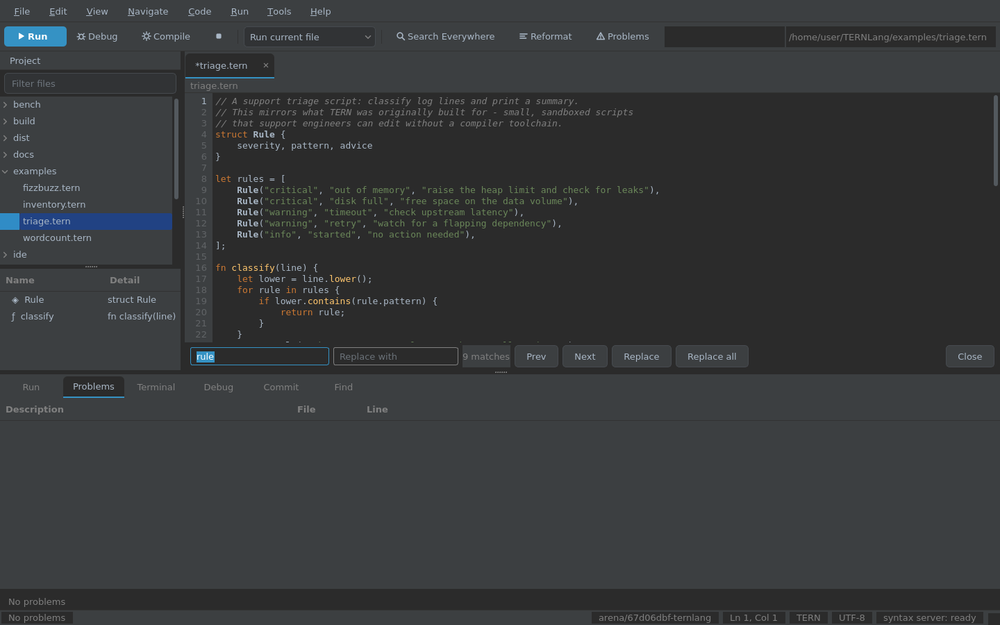
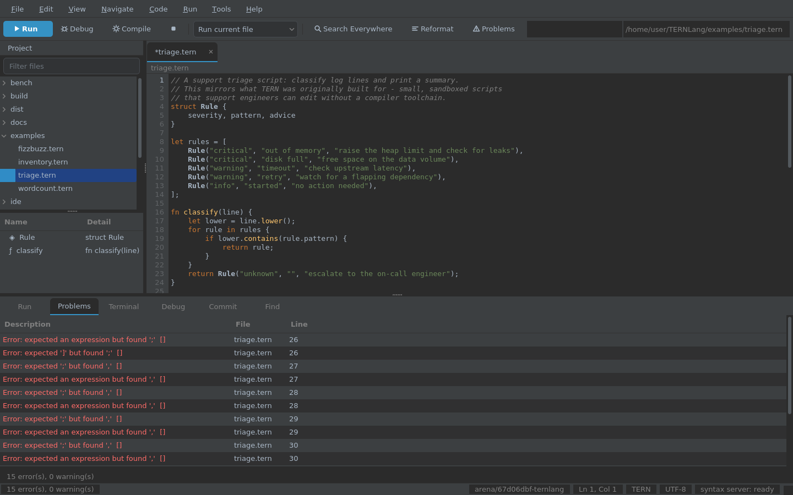
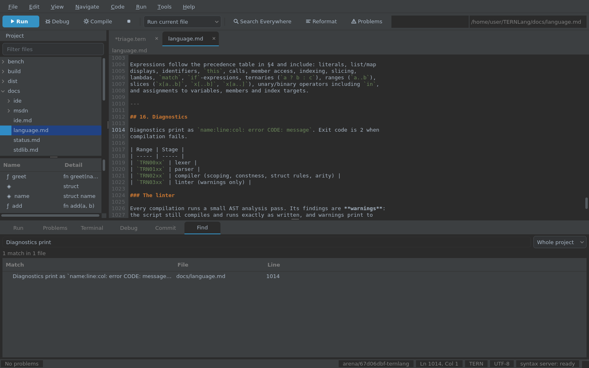
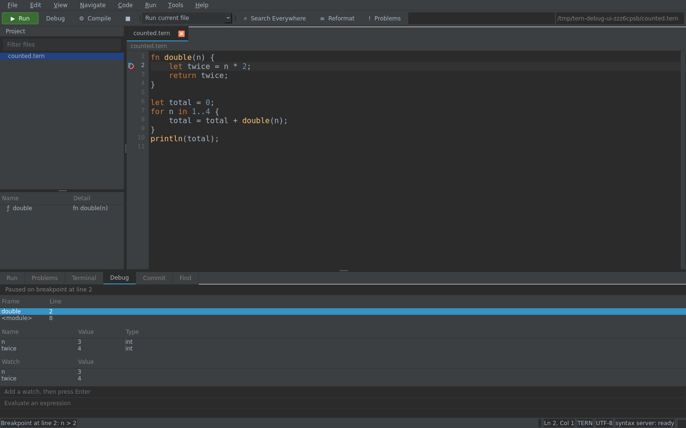

# TERN Studio

TERN Studio is a desktop IDE for TERN, modelled on JetBrains Rider: a shell
with tool windows around an editor, driven by a language server that runs as a
**separate process**. Nothing in the window does its own parsing — every
diagnostic, completion, hover and symbol you see arrived over the Language
Server Protocol.



## Two halves

```
                    stdio (Content-Length framed JSON-RPC, LSP 3.17)
  ide/Studio  ──────────────────────────────────────────────►  ide/Server
  PySide6 window                                                TERN.Ide.dll
  (editor, docks, menus)                                        (.NET, owns the compiler)
```

The split matters for more than tidiness. The server links the TERN compiler
that runs the language, so the IDE reports exactly what `tools/tern run` would
report, and a client other than Studio — VS Code, Neovim, a test harness — gets
the same answers because the protocol is the only interface.

* **`ide/Server/`** — C#, `build/TERN.Ide.dll`. `Program.cs` (dispatch),
  `Rpc.cs` (framing), `Document.cs` (text, line index, positions),
  `SymbolIndex.cs` / `DeepIndex.cs` (symbols, references, structure),
  `Features.cs` (each request).
* **`ide/Studio/`** — Python, PySide6. `window.py` (the shell), `editor.py`
  (edit control, gutter, completion popup), `panels.py` (tool windows),
  `lsp.py` (the child process), `vcs.py` (git), `highlighter.py`, `theme.py`,
  `main.py`.

## Running it

```bash
python3 -m venv .venv
.venv/bin/pip install PySide6-Essentials

bash tools/ide.sh                 # open the repository
bash tools/ide.sh examples        # open a directory
bash tools/ide.sh --screenshot /tmp/studio.png   # render once, headless
```

`tools/ide.sh` finds a Python with PySide6 (`.venv`, then `/tmp/qtenv`, then
`python3`), builds `build/TERN.Ide.dll` if it is missing, and sets `DOTNET_ROOT`
so the server can start. `--theme light|darcula` and `--size 1440x900` are
passed through to the app.

There is no display in this sandbox, so Studio runs on Qt's **offscreen**
platform (`--screenshot` selects it) — it renders and behaves normally, it just
draws into a pixmap instead of a screen. Qt still wants to load four system
libraries it never calls (libGL, libEGL, libxkbcommon, libdbus); on a headless
machine `tools/ide/qt_stubs.py` writes stand-ins for them into
`build/qt-stubs/`, which is why every headless command sets
`LD_LIBRARY_PATH=build/qt-stubs`. On a desktop none of that is needed.

## What the IDE does

| Feature | Where | Notes |
| --- | --- | --- |
| Syntax highlighting | `highlighter.py` | keywords, strings, numbers, comments, types; mirrors `Lexer.cs`, including unterminated strings |
| Live diagnostics | gutter, Problems window, status bar | every keystroke, debounced; errors underline in red and fill the error strip |
| Completion | popup | after `.` and after a quote, plus Ctrl+Space; members, built-ins, imports, keywords |
| Hover documentation | tooltip | name, kind and signature, from the server's symbol index |
| Go to definition | Ctrl+B | jumps to the declaration, in another file if need be |
| Find usages | Alt+F7 | every reference, including inside strings |
| Rename | Shift+F6 | refuses duplicates, keywords and non-identifiers |
| Structure view | left dock | the file's declarations; selecting one jumps there |
| Search Everywhere | Ctrl+Shift+A | files, symbols and text in one list |
| Find in Path | Ctrl+Shift+F | project-wide text or regex search, results in a dock |
| Go to Symbol in File | Ctrl+F12 | filter the open file's declarations and jump |
| Default keymap | Help menu | every shortcut in effect, in one list |
| Run | F5 | runs the current file on the interpreter and streams output to the Run window |
| Compile | Ctrl+F5 | builds and runs it through the native backend |
| Reformat | Ctrl+Alt+L | the server's formatter, 4-space indent |
| Themes | View → Theme | Darcula and light, applied to editor *and* tool windows |
| Tool windows | View | Project, Structure, Run, Problems, Terminal |
| Debugging | Debug window, gutter | breakpoints, stepping, call stack, locals, evaluate |
| Version control | Commit window | git status, stage, commit and a coloured diff view |
| Remembers state | settings | last project, theme, size, open files |

Shortcuts are ordinary Qt ones, so `Ctrl+Q`, `Ctrl+S`, `Ctrl+W`, `Ctrl+Tab`
and `Ctrl++`/`Ctrl+-` behave as expected too.

### The editor

| Key | Does |
| --- | --- |
| `Ctrl+/` | comment or uncomment the line or selection |
| `Ctrl+D` | duplicate the line or selection |
| `Alt+Shift+Up` / `Down` | move the line or selection |
| `Ctrl+F` / `Ctrl+H` / `F3` | find, find and replace, find next |
| `Ctrl+G` | go to line |
| `Ctrl+E` | recent files, filterable |
| `Ctrl+Shift+F` | find in path (project-wide, regex if it parses) |
| `Ctrl+F12` | go to symbol in the current file |
| `Tab` / `Shift+Tab` | indent, unindent (four spaces) |

Brackets and quotes close themselves as you type, a closer already present is
stepped over rather than doubled, a selection is wrapped instead of replaced,
Enter keeps the indentation and adds a level after an opening brace (and takes a
closing brace down with it), and the find bar counts its matches before you
replace all of them.

### Editor details

Line numbers, the current-line highlight, a bracket-matching strip, error
underlines in the gutter, a completion popup that filters as you type and
inserts with Enter or Tab, hover tooltips, and per-tab undo history. The status
bar carries the problem counts, the cursor position, the language, the encoding
and the state of the syntax server — `ready`, `starting` or `stopped`, which
is the first thing to look at when nothing responds.

### Version control

The Commit window lists what git says has changed — a letter and a colour per
status, the staged box, the file and its directory — and commits what is
staged, staging everything if nothing is. Double-clicking a file opens it and
its diff; Ctrl+D shows the diff for whatever is in the editor. Diffs are
coloured line by line, refresh when the window regains focus, and the branch
name, ahead/behind counts and the branch in the status bar come from the same
place.



The find bar, like the rest of the editor keys, stays out of the way until it is
asked for:



When a line is broken, the error shows in three places at once — the gutter, the
Problems window with every message and its line, and the status bar's count:



`ide/Studio/vcs.py` shells out to `git` rather than binding a library: git is
already on the machine that has a repository, and `status --porcelain=v1 -z`
and `diff --unified=3` are stable interfaces. Every call is read-only except
stage, unstage and commit. With no git, or outside a repository, the window
says so and the rest of the IDE is unaffected.

What it does not do: pushing, pulling, branch switching, merges, conflict
resolution and blame. Those are terminal work; this panel is for the loop you
do twenty times an hour — see what changed, check the diff, commit it.

### Find in Path

Ctrl+Shift+F opens a dock with a query box and the results: the matching line,
the file, the number. Typing searches on every keystroke (debounced), the count
appears above the list, and a double-click opens the file at the match. It is a
plain text search over `.tern`, `.md`, `.json` and `.txt` with the usual
suspects skipped (`.git`, `build`, `obj`, `node_modules`), and a regular
expression is used when the query parses as one.



Only `.tern` files are sent to the language server. Opening a Markdown page is
ordinary text editing with a lighter highlighter of its own — headings, code
spans, links and emphasis — and no TERN diagnostics, which is both correct and
the reason a 2,000-line page costs nothing to open. The screenshots in this
file are Markdown, so they show exactly that.

## Debugging

Studio debugs through a third process, for the same reason the language server is
one: the debugger has to be able to stop a program mid-instruction, and that
belongs next to the VM, not in the window.

```
ide/Studio ── one JSON object per line, over stdio ──► ide/Debug (TERN.Debug.dll)
```

Click a gutter line for a breakpoint (Ctrl+F8), Shift+F9 to start. When a
breakpoint fires the program parks inside the VM, the Debug window shows the
call stack and the frame's locals, and Alt+F9 / F8 / F7 / Shift+F8 resume, step
over, step in and step out. Double-clicking a stack frame switches the variables
to it, and a field at the bottom evaluates an expression in the paused frame.



### How a breakpoint works

A debugger cannot simply ask the VM to check a list of lines on every
instruction — that check costs 3–15% on the benchmarks, and the language's speed
is one of its features. So a breakpoint *is* the program: the debugger rewrites
the first instruction of the target line into `Op.Break`, an opcode the compiler
never emits. The dispatch loop already has a `switch`, so a new case costs a
jump-table slot and nothing else; when the case runs it parks the thread until
the client says what to do.

That leaves the problem of code that has not been compiled when the breakpoint
is set. The VM calls `OnFunctionEnter` once per invocation, which the debugger
uses to install breakpoints in functions it has just seen — one predictable
branch per call when a debugger is attached, and a null rather than a call when
it is not.

Measured with `bench/compare/debug_overhead.py`, which runs the benchmarks
through the debugger's own executable with no client attached (the worst case
for the hook): the two columns are within noise of each other, 7.20 s against
7.31 s on a 7-second `fib`.

### What the debugger does not do

* **No conditional breakpoints** — a condition would have to be compiled and
  evaluated per hit; the expression evaluator is there, the trigger is not.
* **No watch expressions** and no data breakpoints.
* **No changing values** while paused: the debugger reads, it does not write.
* **One program at a time**, the file in the current tab. The compiled backend
  (`Ctrl+F5`) is not debuggable — a compiled binary has no VM to hook.
* **Stack frames are a list, not a tree**, so a thread panel would be a lie:
  TERN has no threads.

## Testing

Both halves are covered, and both are part of `tools/test.sh`:

```bash
bash tools/test-ide.sh                                   # 36 assertions, protocol only
python3 tools/debug_test.py                              # 35 checks, debugger only
LD_LIBRARY_PATH=build/qt-stubs .venv/bin/python tools/ide/ui_test.py   # 65 checks, real window
```

`tools/test-ide.sh` drives `TERN.Ide.dll` over stdio with no UI at all: framing,
`initialize` capabilities, didOpen/didChange, diagnostics for a parse error and
their disappearance when fixed, completion items and their sorts, hover,
definition, references, rename (including the refusals), document and workspace
symbols, formatting, and clean `shutdown`/`exit`. `tools/ide/ui_test.py` builds
the real window offscreen and checks what a user would: the outline fills, a
broken line shows up in the editor *and* the Problems window, `math.` offers
`pi` and `sqrt`, hover returns docs, Run prints the program's output, the theme
switch takes effect, and a second file opens as a tab. It also creates a
throwaway git repository, edits a file in it, and checks that the change is
listed with the right letter, that the diff shows the removed and added lines,
and that committing through the panel actually lands a commit in `git log`. It
also drives the editing commands — comment, duplicate, move, find and replace,
recent files — and checks the bytes they produce, searches the project and
follows a match to its line, opens a Markdown page to prove it is not fed to
the TERN analyser, and debugs a script from breakpoint to exit.

Screenshots in this page are generated by `tools/ide/shots.py`, not taken by
hand, so they cannot drift from the code:

```bash
LD_LIBRARY_PATH=build/qt-stubs .venv/bin/python tools/ide/shots.py
```

## Known limits

Honest list, in the order they would annoy someone:

* **The debugger is interpreter-only, one program at a time**, with no
  conditional breakpoints, watch expressions or value editing.
* **No VCS beyond commit.** Status, staging, diffs and commits are there;
  pushing, pulling, branching and merging are not, and modified files are not
  marked in the editor gutter.
* **No project model.** The tree is a file browser; a directory is a project.
  There are no build configurations beyond "run this file".
* **Single-file analysis by default.** Cross-file navigation follows `import`,
  but a symbol defined in a file you have never opened is only found by the
  workspace symbol index, which scans on demand.
* **The formatter is conservative** — indentation and trailing whitespace, not
  a reflow. It will not re-wrap long argument lists.
* **PySide6 is a dependency**, and a heavy one (~150 MB). The server is not: it
  is the same self-contained .NET build everything else uses.

## Doing without a screen

Everything here was developed and tested on a machine with no display, which is
worth recording because it shapes the tests:

* Qt runs on the `offscreen` platform plugin; `window.grab()` returns a real
  pixmap, so screenshots are exact.
* The four missing system libraries are replaced by stand-ins; Qt only needs
  them to *link*, never to run.
* A Qt popup is a separate top-level window and therefore absent from
  `window.grab()`, so `shots.py` draws the popup onto the frame itself at its
  mapped position. Without that the completion screenshot looks empty.
* `ui_test.py` asserts on widget state and text, never on pixels, so it passes
  the same way on a desktop with a display.
