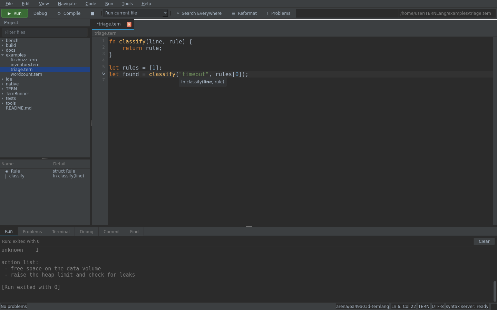
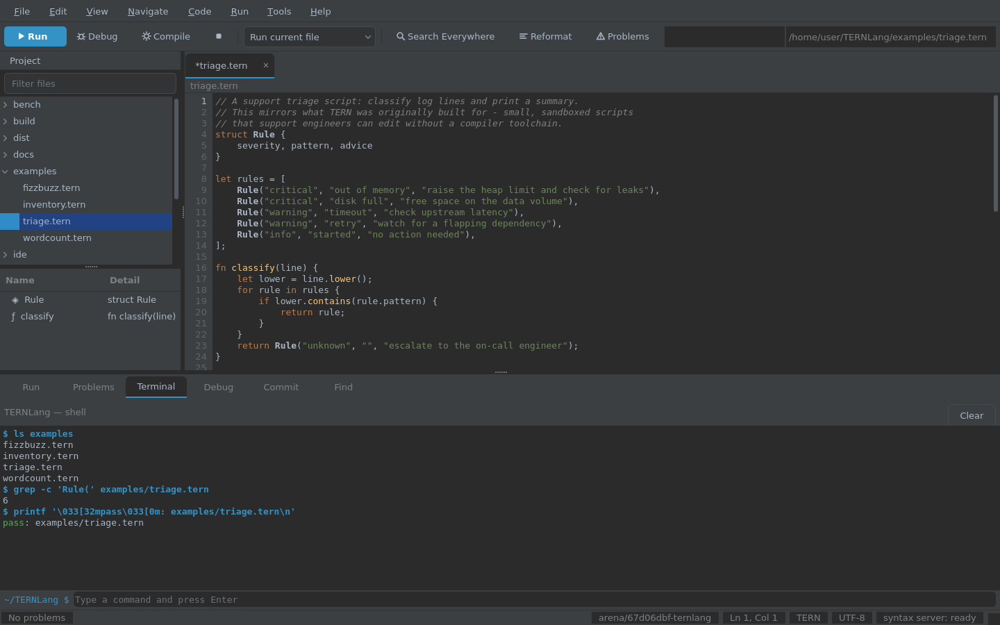

# TERN Studio

TERN Studio is a desktop IDE for TERN, modelled on JetBrains Rider: a shell
with tool windows around an editor, driven by a language server that runs as a
**separate process**. Nothing in the window does its own parsing — every
diagnostic, completion, hover and symbol you see arrived over the Language
Server Protocol.


## Two halves

```
                    stdio (Content-Length framed JSON-RPC, LSP 3.17)
  ide/Studio  ──────────────────────────────────────────────►  ide/Server
  PySide6 window                                                TERN.Ide.dll
  (editor, docks, menus)                                        (.NET, owns the compiler)

                    stdio (one JSON object per line)
  ide/Studio  ──────────────────────────────────────────────►  ide/Debug
  (Debug window, gutter breakpoints)                            TERN.Debug.dll
                                                                (.NET, drives the VM)
```

The split matters for more than tidiness. The server links the TERN compiler
that runs the language, so the IDE reports exactly what `tools/tern run` would
report, and a client other than Studio — VS Code, Neovim, a test harness — gets
the same answers because the protocol is the only interface.

* **`ide/Server/`** — C#, `build/TERN.Ide.dll`. `Program.cs` (dispatch),
  `Rpc.cs` (framing), `Document.cs` (text, line index, positions),
  `SymbolIndex.cs` / `DeepIndex.cs` (symbols, references, structure),
  `Features.cs` (each request).
* **`ide/Studio/`** — Python, PySide6. `window.py` (the shell), `editor.py`
  (edit control, gutter, completion popup), `panels.py` (tool windows),
  `terminal.py` (the shell window), `lsp.py` and `debugger.py` (the two child
  processes), `vcs.py` (git), `highlighter.py`, `theme.py`, `main.py`.
* **`ide/Debug/`** — C#, `build/TERN.Debug.dll`. The debugger: breakpoints,
  stepping, frames, variables, over its own line protocol.

## Running it

Three commands, from a clean checkout:

```bash
bash tools/setup-toolchain.sh                     # .NET runtime + Roslyn, once
python3 -m venv .venv && .venv/bin/pip install "PySide6-Essentials==6.9.3"
bash tools/ide.sh                                 # open this repository
```

**On Windows** the same three steps, in cmd:

```bat
dotnet build                                  :: needs the .NET 8 SDK
python -m venv .venv
.venv\Scripts\pip install "PySide6-Essentials==6.9.3"
tools\ide.cmd
```

The venv layout is the one thing that differs: `bin/` on Unix, `Scripts\` on
Windows, and `pip` there is `pip.exe`. `tools\ide.cmd` runs the same
`tools/studio.py` as `tools/ide.sh`, so there is one launcher to reason about.
With the SDK present the toolchain bootstraps itself — `dotnet build` writes the
three assemblies into `build/`, and `tools/studio.py` finds them there.

Then:

```bash
bash tools/ide.sh examples                        # open a directory
bash tools/ide.sh --theme eclipse                 # Darcula is the default
bash tools/ide.sh --screenshot /tmp/studio.png    # render once, headless
```

`tools/studio.py` finds a Python with PySide6 (this one, then `.venv` or
`venv` with either layout — searched in the directory the launcher was run from
and its parents as well as the repository root, so a virtualenv made after
`cd tools` still counts — then `/tmp/qtenv`, then `python3`), builds the runner,
syntax server and debugger if any is missing — Run and Debug are part of the
IDE, so they are built together on a first launch rather than failing later —
and sets `DOTNET_ROOT` only when the runtime is the bundled one, since a system
`dotnet` must not be pointed at it. `--theme darcula|light|eclipse|vs-dark|carbon` and
`--size 1440x900` are passed through to the app.

### What differs between platforms

| | Linux / macOS | Windows |
| --- | --- | --- |
| virtualenv | `.venv/bin/python` | `.venv\Scripts\python.exe` |
| launcher | `tools/ide.sh` | `tools\ide.cmd` |
| build | `tools/build.py` (Roslyn bootstrap) | `dotnet build` with the .NET 8 SDK |
| runtime | `build/dotnet` | `dotnet` on `PATH` |
| terminal shell | `bash` | `bash` if installed (Git Bash, WSL), else `cmd.exe` |
| Ctrl+C in the terminal | SIGINT to the shell's group, then a new shell | `taskkill /T`, then a new shell |

File paths and URIs are the other place this can go wrong, quietly: a Windows
path becomes `file:///C:/Users/...` — three slashes, because a URI's path always
starts with `/` — and comes back as `C:/Users/...`. `ide/Studio/paths.py` does
that, and the UI suite checks the Windows cases on Linux, where a mistake would
otherwise only appear on somebody else's machine.

There is no display in this sandbox, so Studio runs on Qt's **offscreen**
platform (`--screenshot` selects it) — it renders and behaves normally, it just
draws into a pixmap instead of a screen. Qt still wants to load four system
libraries it never calls (libGL, libEGL, libxkbcommon, libdbus); on a headless
machine `tools/ide/qt_stubs.py` writes stand-ins for them into
`build/qt-stubs/`, which is why every headless command sets
`LD_LIBRARY_PATH=build/qt-stubs`. On a desktop none of that is needed.

PySide6 is pinned to the 6.9 LTS line. 6.12.0 has a refcount regression in
shiboken: re-highlighting a large document with `QSyntaxHighlighter`
repeatedly — which is exactly what switching themes does — aborts the
process with `Fatal Python error: none_dealloc`. The same code runs cleanly
on 6.9.3, so `tools/test.sh` and the launcher prefer an interpreter that has
it.

## Packaging it

`python tools/package.py` runs PyInstaller over the application and writes
`dist/TERN Studio/` — on Windows, `TERN Studio.exe` plus everything it needs in
the same folder. Nothing Python is needed on the machine that runs it, and there
is no virtualenv to activate first, which is the point.

```bat
dotnet build                       :: the three .NET assemblies
tools\ide.cmd                        :: once, to make sure it runs
.venv\Scripts\pip install pyinstaller
.venv\Scripts\python tools\package.py
dist\TERN Studio\TERN Studio.exe
```

The build copies `build\*.dll` next to the executable, under a `build\`
folder, because that is where `runtime.assembly()` looks — the assemblies are
not embedded in the bundle. PyInstaller flattens its inputs into an archive and
`dotnet` cannot run a managed assembly out of one; more to the point, the .NET
runtime is not ours to ship. A machine without it opens the window and the
editor, and the Run window says exactly what is missing instead of failing
silently.

Two flags matter: `--onefile` produces a single executable which unpacks itself
to a temporary directory on every start (slower to launch, and the copied
`build\` folder has to sit beside it), and `--console` keeps a console window so
a crash has somewhere to print. The default is a folder build without a console,
because Studio has a terminal panel of its own.

Qt is pruned to the modules Studio imports; `tools/test_package.py` checks that
nothing the code imports is on the exclusion list.

## What the IDE does

| Feature | Where | Notes |
| --- | --- | --- |
| Syntax highlighting | `highlighter.py` | keywords, strings, numbers, comments, types; mirrors `Lexer.cs`, including unterminated strings |
| Live diagnostics | gutter, Problems window, status bar | every keystroke, debounced; errors underline in red and fill the error strip |
| Completion | popup | after `.` and after a quote, plus Ctrl+Space; members, built-ins, imports, keywords |
| Hover documentation | tooltip | name, kind and signature, from the server's symbol index |
| Signature help | hint under the caret | the enclosing call and its parameters, the one being typed in bold |
| Go to definition | Ctrl+B | jumps to the declaration, in another file if need be |
| Find usages | Alt+F7 | every reference, including inside strings |
| Rename | Shift+F6 | refuses duplicates, keywords and non-identifiers |
| Structure view | left dock | the file's declarations; selecting one jumps there |
| Search Everywhere | Ctrl+Shift+A | files, symbols and text in one list |
| Find in Path | Ctrl+Shift+F | project-wide text or regex search, results in a dock |
| Go to Symbol in File | Ctrl+F12 | filter the open file's declarations and jump |
| Default keymap | Help menu | every shortcut in effect, in one list |
| Run | F5 | runs the current file on the interpreter and streams output to the Run window |
| Stop | Ctrl+C, Ctrl+F2 | ends the running program (or a compile) and takes the whole process tree with it |
| Compile | Ctrl+F5 | builds and runs it through the native backend |
| Reformat | Ctrl+Alt+L | the server's formatter, 4-space indent |
| Themes | View → Theme | Darcula, IntelliJ Light, Eclipse, Visual Studio Dark and Carbon — applied to the editor *and* every tool window, because they all read one palette |
| Tool windows | View | Project, Structure, Run, Problems, Terminal, Debug, Commit, Find |
| Terminal | Alt+F12 | a real shell in a dock — `bash`, or `cmd.exe` on Windows — with colours, history, Ctrl+C and Ctrl+L |
| Debugging | Debug window, gutter | breakpoints (with conditions), watches, stepping, call stack, locals, evaluate |
| Version control | Commit window | git status, stage, commit and a coloured diff view |
| Remembers state | settings | last project, theme, size, open files |

Shortcuts are ordinary Qt ones, so `Ctrl+Q`, `Ctrl+S`, `Ctrl+W`, `Ctrl+Tab`
and `Ctrl++`/`Ctrl+-` behave as expected too.

### The look

Two decisions account for most of it.

**Fusion, not the platform style.** `main.py` sets `QApplication.setStyle("Fusion")`
before the stylesheet. The native Windows style draws its own beveled buttons,
combo boxes and spin buttons and ignores most of what a stylesheet says about
them, so the window kept a 2009 chrome no matter which palette was selected —
which is what "3D buttons" was. Fusion is identical on every platform, so the
stylesheet is the whole of the appearance and a screenshot taken here is what a
Windows machine shows.

**Icons are drawn, not typed.** A glyph like `▶` or `⚙` is whatever the fonts on
the machine decide it is, which is how a gear became a circle and a close button
became a red square. `ide/Studio/icons.py` holds the shapes as SVG, writes one
file per colour into the temporary directory and hands back a path; the
stylesheet references that path and the toolbar gets a `QIcon` from it. Vector
means crisp at any scaling factor, and nothing binary is committed.

Everything else is derived: hover and pressed colours are computed from the
palette by `theme.blend()`, so a theme is a table of about twenty colours and no
per-widget hand-tuning.

### Stopping things

Ctrl+C ends whatever is running, from wherever the cursor is: the Run window's
output, the terminal's scrollback, the terminal's prompt, or the Stop button
beside them. The terminal sends SIGINT to the shell's process group on Unix and
`taskkill /T` on Windows; the Run window kills the process tree the same way,
and a compile in progress counts as a run.

Getting there needed two fixes worth naming, because neither was visible from a
test that called the handler directly:

* the console and terminal filters were installed on the *prompt box* only, so
  Ctrl+C did nothing once you clicked into the output — which is exactly where
  you click to read what a stuck program printed;
* `Ctrl+C` was also a window-level shortcut for **Copy**, and a window shortcut
  is delivered before the focused widget ever sees the key. The clipboard
  actions have no shortcut now; the widgets handle their own keys, and the menu
  items act on whatever has focus.

### The terminal

The Terminal window is a shell, not a log view. It runs `bash --norc
--noprofile` under `setsid`, in a session of its own, and sends each line from
the prompt box, so `cd`, environment variables and shell syntax all behave as
they do in a terminal. A command is written as `cmd`, then `__tern_status=$?`
and a marker line carrying the exit status and `$PWD`; the panel reads that
marker back, updates the prompt and shows the status in the dock's title bar.

Output is decoded from SGR sequences: 16- and 256-colour foregrounds become
colour runs in the view, so `ls --color`, `grep --color` and coloured compiler
output look right.

There is no pseudo-terminal here — `forkpty` needs a device this sandbox does
not provide — so the shell reads commands from a pipe and has no job control.
That has one visible consequence. Ctrl+C stops the running command with
SIGINT (SIGTERM if it ignores it) and then starts a fresh shell in the same
directory: the working directory and the history survive, shell variables do
not. A real terminal would keep the shell and return it to its prompt. The
session matters: the signal is sent to the shell's own process group, so it
can never reach the IDE. Ctrl+L clears, Up and Down walk the history, and
Ctrl+Alt+T runs a typed command in the window. Full-screen programs (`top`,
`vim`) are out of scope for the same reason.

### The editor

| Key | Does |
| --- | --- |
| `Ctrl+/` | comment or uncomment the line or selection |
| `Ctrl+D` | duplicate the line or selection |
| `Alt+Shift+Up` / `Down` | move the line or selection |
| `Ctrl+F` / `Ctrl+H` / `F3` | find, find and replace, find next |
| `Ctrl+G` | go to line |
| `Ctrl+E` | recent files, filterable |
| `Alt+3` / `Alt+5` / `Alt+0` | Find / Debug / Commit window |
| `Ctrl+Shift+F` | find in path (project-wide, regex if it parses) |
| `Ctrl+Shift+E` | open recent (the files opened this session) |
| `Ctrl+Alt+T` | run a command in the Terminal window |
| `Ctrl+F12` | go to symbol in the current file |
| `Tab` / `Shift+Tab` | indent, unindent (four spaces) |

Brackets and quotes close themselves as you type, a closer already present is
stepped over rather than doubled, a selection is wrapped instead of replaced,
Enter keeps the indentation and adds a level after an opening brace (and takes a
closing brace down with it), and the find bar counts its matches before you
replace all of them.

### Editor details

Line numbers, the current-line highlight, a bracket-matching strip, error
underlines in the gutter, a completion popup that filters as you type and
inserts with Enter or Tab, hover tooltips, and per-tab undo history. The status
bar carries the problem counts, the cursor position, the language, the encoding
and the state of the syntax server — `ready`, `starting` or `stopped`, which
is the first thing to look at when nothing responds.

### Version control

The Commit window lists what git says has changed — a letter and a colour per
status, the staged box, the file and its directory — and commits what is
staged, staging everything if nothing is. Double-clicking a file opens it and
its diff; Ctrl+D shows the diff for whatever is in the editor. Diffs are
coloured line by line, refresh when the window regains focus, and the branch
name, ahead/behind counts and the branch in the status bar come from the same
place.


The find bar, like the rest of the editor keys, stays out of the way until it is
asked for:


When a line is broken, the error shows in three places at once — the gutter, the
Problems window with every message and its line, and the status bar's count:


While a call is being written, the hint under the caret names the enclosing
function and bolds the argument being typed:



The Terminal window is a shell in a dock, so project commands run where the
code is:



`ide/Studio/vcs.py` shells out to `git` rather than binding a library: git is
already on the machine that has a repository, and `status --porcelain=v1 -z`
and `diff --unified=3` are stable interfaces. Every call is read-only except
stage, unstage and commit. With no git, or outside a repository, the window
says so and the rest of the IDE is unaffected.

What it does not do: pushing, pulling, branch switching, merges, conflict
resolution and blame. Those are terminal work; this panel is for the loop you
do twenty times an hour — see what changed, check the diff, commit it.

### Find in Path

Ctrl+Shift+F opens a dock with a query box and the results: the matching line,
the file, the number. Typing searches on every keystroke (debounced), the count
appears above the list, and a double-click opens the file at the match. It is a
plain text search over `.tern`, `.md`, `.json` and `.txt` with the usual
suspects skipped (`.git`, `build`, `obj`, `node_modules`), and a regular
expression is used when the query parses as one.


Only `.tern` files are sent to the language server. Opening a Markdown page is
ordinary text editing with a lighter highlighter of its own — headings, code
spans, links and emphasis — and no TERN diagnostics, which is both correct and
the reason a 2,000-line page costs nothing to open. The screenshots in this
file are Markdown, so they show exactly that.

## Debugging

Studio debugs through a third process, for the same reason the language server is
one: the debugger has to be able to stop a program mid-instruction, and that
belongs next to the VM, not in the window.

```
ide/Studio ── one JSON object per line, over stdio ──► ide/Debug (TERN.Debug.dll)
```

Click a gutter line for a breakpoint (Ctrl+F8), Shift+F9 to start. When a
breakpoint fires the program parks inside the VM, the Debug window shows the
call stack and the frame's locals, and Alt+F9 / F8 / F7 / Shift+F8 resume, step
over, step in and step out. Double-clicking a stack frame switches the variables
to it, and a field at the bottom evaluates an expression in the paused frame.

### Conditions and watches

`Ctrl+Shift+F8` attaches a condition to the breakpoint on the caret line;
`Ctrl+Shift+F7` adds a watch. A conditioned breakpoint is drawn as a ring in
the gutter rather than a filled dot, so the two are told apart at a glance, and
a watch is a name or expression re-evaluated at every stop, kept across runs.

The condition language is small on purpose — name, `!name`, or a comparison of
a name with a literal or another name:

```
total == 6          name != "error"          n > 2
ready               !found                   count >= limit
```

Anything the debugger cannot read stops anyway. A condition that is silently
false when it should be true is the worst failure a debugger can have; a stop
where you did not expect one shows you why immediately.

Conditions are evaluated in the debugger, not the VM: at the stop the
instruction has already been restored, the VM is parked, and the expression
reads the frame's locals directly. A condition that says no does not wake the
client — the debugger restores the patch, re-arms the breakpoint so the next
pass round the loop is judged again, and carries on.


### How a breakpoint works

A debugger cannot simply ask the VM to check a list of lines on every
instruction — that check costs 3–15% on the benchmarks, and the language's speed
is one of its features. So a breakpoint *is* the program: the debugger rewrites
the first instruction of the target line into `Op.Break`, an opcode the compiler
never emits. The dispatch loop already has a `switch`, so a new case costs a
jump-table slot and nothing else; when the case runs it parks the thread until
the client says what to do.

That leaves the problem of code that has not been compiled when the breakpoint
is set. The VM calls `OnFunctionEnter` once per invocation, which the debugger
uses to install breakpoints in functions it has just seen — one predictable
branch per call when a debugger is attached, and a null rather than a call when
it is not.

Measured with `bench/compare/debug_overhead.py`, which runs the benchmarks
through the debugger's own executable with no client attached (the worst case
for the hook): the two columns are within noise of each other, 7.20 s against
7.31 s on a 7-second `fib`.

### What the debugger does not do

* **No arbitrary expressions in conditions**: comparisons, negation and names,
  not calls or arithmetic. A condition needing `f(x)` has to be turned into a
  variable the program writes.
* **No data breakpoints**, and watches are evaluated, not editable.
* **No changing values** while paused: the debugger reads, it does not write.
* **One program at a time**, the file in the current tab. The compiled backend
  (`Ctrl+F5`) is not debuggable — a compiled binary has no VM to hook.
* **Stack frames are a list, not a tree**, so a thread panel would be a lie:
  TERN has no threads.

## Testing

Both halves are covered, and both are part of `tools/test.sh`:

```bash
bash tools/test-ide.sh                                   # 39 assertions, protocol only
python3 tools/debug_test.py                              # 41 checks, debugger only
LD_LIBRARY_PATH=build/qt-stubs .venv/bin/python tools/ide/ui_test.py   # 128 checks, real window
.venv/bin/python tools/test_package.py                   # 12 checks, packaging
```

`tools/test-ide.sh` drives `TERN.Ide.dll` over stdio with no UI at all: framing,
`initialize` capabilities, didOpen/didChange, diagnostics for a parse error and
their disappearance when fixed, completion items and their sorts, hover,
definition, references, rename (including the refusals), document and workspace
symbols, formatting, and clean `shutdown`/`exit`. `tools/ide/ui_test.py` builds
the real window offscreen and checks what a user would: the outline fills, a
broken line shows up in the editor *and* the Problems window, `math.` offers
`pi` and `sqrt`, hover returns docs, Run prints the program's output, the theme
switch takes effect, and a second file opens as a tab. It also creates a
throwaway git repository, edits a file in it, and checks that the change is
listed with the right letter, that the diff shows the removed and added lines,
and that committing through the panel actually lands a commit in `git log`. It
also drives the editing commands — comment, duplicate, move, find and replace,
recent files — and checks the bytes they produce, searches the project and
follows a match to its line, opens a Markdown page to prove it is not fed to
the TERN analyser, and debugs a script from breakpoint to exit. The Terminal
is checked by running real commands in it: `echo`, `cd` with the prompt
following, a failing status in the title bar, ANSI colour in the document,
Ctrl+Alt+T from the menu, Ctrl+C against a sleeping command, Up-arrow
history, Ctrl+L, and a restart after `exit`. The debugger is exercised the same way:
a conditioned breakpoint set through the window must stop on the iteration the
condition picks, and a watch must show the value at that stop.

Screenshots in this page are generated by `tools/ide/shots.py`, not taken by
hand, so they cannot drift from the code:

```bash
LD_LIBRARY_PATH=build/qt-stubs .venv/bin/python tools/ide/shots.py
```

### What the completion suite checks

The window suite types into a real editor one key at a time and asserts on what
the popup shows, because calling `set_completions()` directly — which is what it
used to do — proved nothing: every layer between the keystroke and the list was
broken and the test could not tell. Typing `math.` has to yield the library's
members rather than the keyword list, typing `sqr` has to narrow it to `sqrt`
without another round-trip, and Tab has to insert it.

That regression had a cause worth remembering: **the editor never told the
language server that the text had changed.** `didOpen` was sent once, on open,
and the server answered every subsequent question about the file as it had been
on disk. Diagnostics, hover and go-to-definition were all computed against stale
text; completion was the one where it was obvious, because the list was full of
keywords that were not valid after a dot.

## Known limits

Honest list, in the order they would annoy someone:

* **The debugger is interpreter-only, one program at a time.** Breakpoints
  take a condition and watches are evaluated at every stop, but conditions
  cannot call functions and paused values cannot be edited.
* **No VCS beyond commit.** Status, staging, diffs and commits are there;
  pushing, pulling, branching and merging are not, and modified files are not
  marked in the editor gutter.
* **No project model.** The tree is a file browser; a directory is a project.
  There are no build configurations beyond "run this file".
* **Single-file analysis by default.** Cross-file navigation follows `import`,
  but a symbol defined in a file you have never opened is only found by the
  workspace symbol index, which scans on demand.
* **The formatter is conservative** — indentation and trailing whitespace, not
  a reflow. It will not re-wrap long argument lists.
* **PySide6 is a dependency**, and a heavy one (~150 MB). The server is not: it
  is the same self-contained .NET build everything else uses. `tools/package.py`
  removes the need for a Python installation on the target machine, not for the
  .NET runtime.
* **Packaging has not been run end to end in the sandbox.** PyInstaller needs a
  CPython built with a shared `libpython` and a C toolchain to collect against;
  the machine this was developed on has neither, and cannot fetch one. The
  command, the exclusions and the entry point are tested
  (`tools/test_package.py`), and the entry point is run to a rendered window —
  but `dist/` has never been produced here. The first Windows run is the missing
  step.

## Doing without a screen

Everything here was developed and tested on a machine with no display, which is
worth recording because it shapes the tests:

* Qt runs on the `offscreen` platform plugin; `window.grab()` returns a real
  pixmap, so screenshots are exact.
* The four missing system libraries are replaced by stand-ins; Qt only needs
  them to *link*, never to run.
* A Qt popup is a separate top-level window and therefore absent from
  `window.grab()`, so `shots.py` draws the popup onto the frame itself at its
  mapped position. Without that the completion screenshot looks empty.
* `ui_test.py` asserts on widget state and text, never on pixels, so it passes
  the same way on a desktop with a display.
